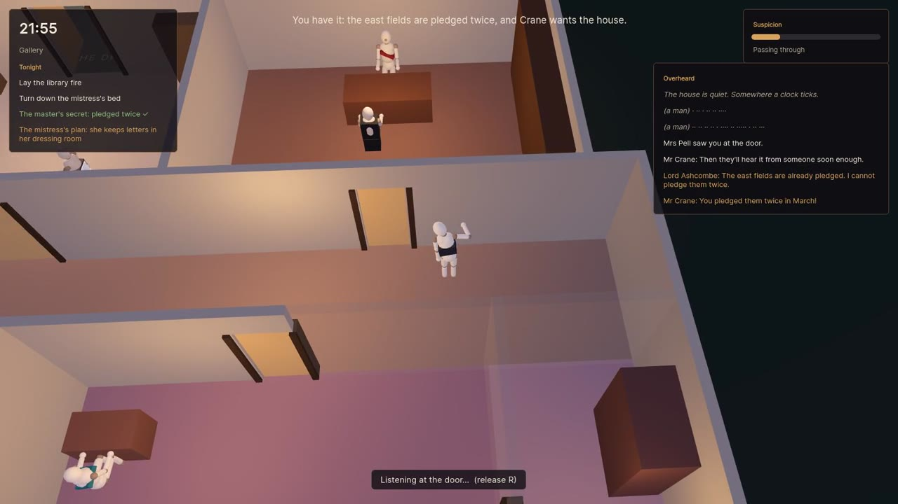
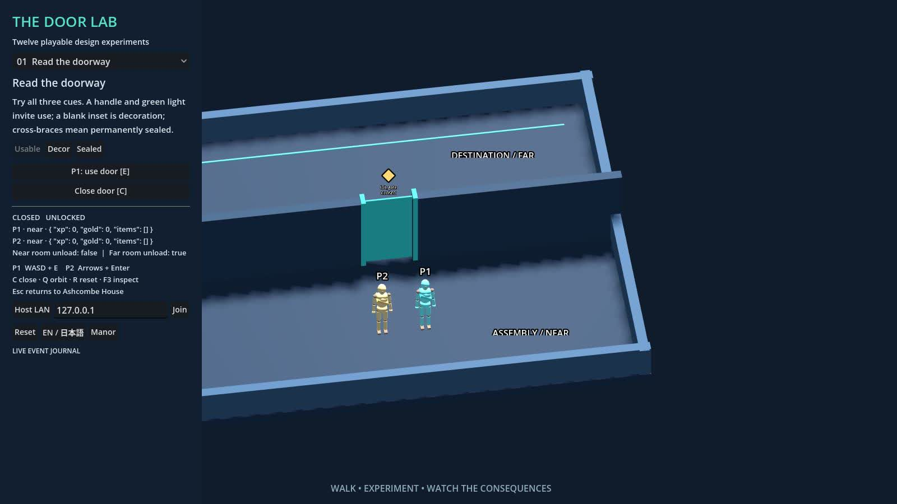

# godot-doors

Rooms and doors for Godot 4: who may pass, who can hear, who can see, who knocks,
who gets caught, and which rooms keep running while the player is elsewhere.

- Engine: Godot 4.7. GDScript, typed. The addon has no dependencies.
- Demo: **Ashcombe House**, a short social-stealth night in a small manor, made
  with [godot-uxml](https://github.com/splatterfacegames/godot-uxml) for the HUD,
  [Typesetter](https://github.com/splatterfacegames/godot-typesetter) for in-world
  text, and procedural jointed mannequins for the cast.
- Site and web build: [doorproblem.splatterfacegames.com](https://doorproblem.splatterfacegames.com)

[](docs/media/reel.mp4)

A 56-second tour of the demo: [docs/media/reel.mp4](docs/media/reel.mp4). It is also on
the [site](https://doorproblem.splatterfacegames.com).

**Satire for X:** [78-second MP4](docs/media/door-problem-x.mp4),
[script and credits](docs/media/door-problem-script.md),
[captions](docs/media/door-problem-x.srt). Forty seconds are MiniMax H3 scenes generated
through ai&; the gameplay portion is labeled. The satire targets human exceptionalism,
not England's explanation of the work involved in game design.

## The door problem

In 2014 Liz England wrote [The Door Problem](https://www.lizengland.com/blog/2014/04/the-door-problem/),
a short post that answers the question "what does a game designer do?" with a door.
The point of the post: a door looks like the simplest object in a level, but nearly every
discipline on the team has to make a decision about it.

- **Design** decides whether the player can open it, and whether it locks, and with what.
  Does it open automatically? Can the player block it? Can enemies open it?
- **Level design** decides where doors go, how big they are, and what is behind them.
- **Art** makes the door and its frame and decides how a locked door looks different.
- **Animation** decides how a character opens it: with a hand, a shoulder or a kick, and
  from which side.
- **Programming** writes the state, the collision, the pathing through it and the
  bugs where it closes on someone.
- **Audio** gives it a creak, a latch and a knock, and decides how far each sound carries.
- **Narrative** puts something behind it that matters.
- **AI** teaches the NPCs to use it: do they open it, close it after themselves, stop at
  it, see the player through it?
- **QA** opens it from both sides, at the same time, while carrying things, a thousand times.
- **Production** schedules all of the above.

England's post is a list of questions, not a solution. Each team answers them again for
each game, usually one at a time, as bugs.

**Try the alternatives:** choose **Door Lab** on the title screen for twelve playable
experiments: readable/decorative/sealed entrances, manual and proximity opening,
key/puzzle/hack/story gates, directional and view-only passages, local co-op and room
retention, obstruction, group closure, wait/teleport transitions, body clearance,
ally queues, hidden reinforcements, and earned rewards/timed access. These use the
optional `DoorPolicies` layer on the same authoritative addon.

[Every question and every role in the original essay](docs/door-problem-decisions.md)
has an explicit project decision and implementation reference. This is a set of
working design alternatives, not a claim that one manor implements every possible game.

### What this repository does about it

Most games treat a door as level dressing with a collision box. In a game about a house
full of people with secrets, a door is several systems at once:

| A door is a… | It decides… | In the addon |
| --- | --- | --- |
| movement gate | who may pass, how loudly, and whether the swing is blocked | `try_open`, `may_pass`, keys, master keys, `BLOCKED`/`HELD`/`JAMMED` |
| information gate | what can be heard or seen through it, by whom | `hear_check`, `sight_check`, `witnesses_of`, LISTEN and PEEK postures |
| social instrument | knocking, being admitted, being announced, being found | `knock`, `announce`, `KnockPolicy`, admission, `discovery` |
| content gate | which scenes may start, and how restricted ones resolve | `scene_preconditions_met`, `request_scene`, fade-to-black |
| simulation boundary | which rooms keep running when the player is not there | residency tiers, activities that run at every tier |

The design rule that follows is simple: **one authority**. No script keeps its own
"is this door open". Everything asks the `RoomsAndDoors` autoload, and the scenes
(`Door.tscn`, `RoomArea`) are thin views. That gives every discipline in England's list
the same answers:

- **Design:** doors have three states (CLOSED, AJAR, OPEN) plus flags (locked, held,
  blocked, jammed). AJAR is the eavesdropper's state: it blocks bodies but not sound.
  Locks need keys; a master key lists the keys it substitutes for.
- **Social design:** being *in* a room and being *allowed* in it are different. Admission is
  computed: owner, resident, invited, on duty (chores grant bounded access), or none.
  Consequences hang off admission, not presence: a servant on duty is invisible, and the same
  servant one minute after the chore ends is a discovery.
- **Audio and AI:** every door action makes noise:
  `sound_level × (quiet ? 0.25 : 1) × (force ? 3 : 1)`. Noise travels the door graph.
  A closed door passes `hearing_factor` of it, an ajar door more, an open door all of it.
  Sleepers need 2.5× more to wake. Someone pressed against the door with an ear (LISTEN)
  needs 0.4× as much, and catches who is speaking.
- **Narrative:** witnesses are never authored by hand. `witnesses_of(room, loudness)`
  returns everyone who perceives an event, so gossip, discovery and reputation all start
  from the same list.
- **AI:** `NpcDoorAgent` paths with `may_pass`. It knocks when it has business, waits or
  reroutes when it does not, opens ajar doors fully before going through (and so notices
  them: `ajar_discovered`), and closes doors behind itself the way its role would.
- **Simulation:** rooms one door from the player are fully resident, always. Rooms two doors
  away run at lower fidelity. Rooms three or more doors away advance on the clock. A
  private scene that started while the player was elsewhere is joined in progress, never
  restarted.
- **QA:** an occupancy change between two rooms with no open door between them emits
  `door_clip_detected`. The acceptance suite runs 130 checks headless. The debug overlay
  (F3 in the demo) draws the room graph, door states, witnesses and the last 20 events.

## The demo: Ashcombe House

You are the new maid. Tonight the master has a visitor, the mistress is writing a letter,
and every door in the house listens back. Find out what the house is hiding before it
finds out what you are doing.

```
godot --path .                       # play (the main scene is demo/main.tscn)
```

| Key | Action |
| --- | --- |
| WASD / arrows | walk (Shift: sneak, doors open quietly) |
| E | open, close, unlock, use (hold for chores) |
| F | knock |
| G | leave a door ajar |
| L | lock or unlock |
| hold R | listen at a door |
| hold T | peek through a keyhole |
| Z / X | turn the camera |
| F3 | RoomsAndDoors debug overlay |
| Esc | pause and controls |

Every rule in the demo comes from the addon:

- The study conversation is an *activity*. Each line goes through `hear_check` for the maid.
  She sees a line in full if she identified it, as dots if she only heard it, and not at all
  otherwise.
- Chores (`set_duty`) make the maid ON_DUTY in the library and the bedchamber. Duty also
  lends her key access to those rooms. If she stays more than twice the expected time, the
  house notices.
- Mr Crane knocks at the study and the master's `KnockPolicy` admits him, because he was
  invited. The master then locks the door behind him.
- The mistress bolts her door from the inside and goes to sleep. The servants' jib door on
  the back stair is the other way in. Open it quietly, or she wakes up and finds you.
- Mrs Pell's patrol closes every door she passes. If she finds a door you left ajar, it costs
  you suspicion.

### Door Lab and native co-op

Choose **Door Lab** from the title screen, or run `godot --path . -- --door-lab`.
Use its experiment list and variant buttons to change the rules. P1 uses WASD/E;
P2 uses arrows/Enter. The lab displays its controls, current room retention, progress,
and the reason each interaction succeeds or fails. Reset restores the experiment.



Native LAN: use **Host LAN** on one machine and enter its address on the other, or run:

```
godot --path . -- --door-lab --host
godot --path . -- --door-lab --join=192.168.1.20
```

The transport uses UDP 7077. Host controls P1; the client controls P2 with WASD or arrows
and E. The server owns movement and door decisions. The browser build offers local
two-player experiments; ENet host/join requires a native build.

`DoorPolicies` and `DoorNetwork` are optional scene nodes. Configure policies after
registering doors; bind each connected peer to its registered actor on the server.
The existing save format includes mutable policy progress. Reapply authored gameplay
configuration when restoring a scene; physical threshold occupancy is rebuilt from bodies.

The house is built from a data table (`demo/manor_layout.gd`): walls are generated
around the room rectangles, with openings where the doors are. A navigation mesh is
baked from the result at startup. Walls, furniture and closed doors are obstacles, so
each room is its own island. NPCs path around furniture inside a room and cross a
doorway in a straight line, and only when `NpcDoorAgent` says the door is open. The smoke
run counts any frame where a walking NPC is inside furniture and fails if there is one.
`-- --no-nav` turns the mesh off for comparison: with it off, the same night has 36
such frames. The cast are
`Mannequin`s (`demo/mannequin.gd`), jointed figures made from primitives with a
procedural walk and poses for listening, peeking, knocking, working, sitting, reading
and sleeping. No art assets are needed.

## Using the addon

1. Copy `addons/rooms_and_doors` into your project.
2. Add the autoload: `RoomsAndDoors="*res://addons/rooms_and_doors/rooms_and_doors.gd"`.
3. Put a `RoomArea` (or `RoomArea2D`) in each room and a `Door.tscn` in each doorway.
   Register your characters.

```gdscript
RoomsAndDoors.register_character(&"maid", $Maid, { "role": &"servant" })
RoomsAndDoors.set_player(&"maid")
RoomsAndDoors.set_duty(&"maid", &"study", { "duration": 120.0 })

var r := RoomsAndDoors.try_open(&"study_door", &"maid", { "quiet": true })
if not r.ok:
    print(r.reason)                       # LOCKED, NO_KEY, BLOCKED, HELD, ...

var h := RoomsAndDoors.hear_check(&"maid", &"study", RAD.LOUD_CONVERSATION)
if h.identified:
    print(h.participants)

RoomsAndDoors.discovery.connect(func(who, finder, room, ctx): print(finder, " found ", who))
```

Project settings: `rooms_and_doors/debug/overlay` and `rooms_and_doors/content/fade_to_black`.

The full design, section by section, is in [docs/design.md](docs/design.md). The public
API lives in [`rooms_and_doors.gd`](addons/rooms_and_doors/rooms_and_doors.gd). Its
documentation comments follow the sections of the design.

| File | What it is |
| --- | --- |
| `rooms_and_doors.gd` | the autoload: the only owner of state |
| `rad.gd` | `RAD`: enums (Privacy, DoorState, Admission, Posture, Tier), reasons, loudness presets |
| `Door.tscn`, `door.gd` | door view: blocking body, hinge, placeholder clips and procedural sounds, swing sensor |
| `room_area.gd`, `room_area_2d.gd` | room volumes that report occupancy |
| `key_item.gd` | world keys and keyrings |
| `knock_policy.gd` | how an owner answers knocks |
| `npc_door_agent.gd` | door protocol for NPCs: timed, or driven by your locomotion |
| `debug_overlay.gd` | the overlay |

## Tests

```
godot --headless --path . --import
godot --headless --path . res://tests/doors_test.tscn          # 130 checks; exit code = failures
godot --headless --path . res://demo/main.tscn -- --smoke      # plays the night with an autopilot
```

The demo has two recording modes. `-- --shots=<dir>` saves a set of screenshots.
`-- --reel` plays the captioned tour. Use it with Movie Maker:

```
godot --path . --write-movie reel.avi --fixed-fps 30 res://demo/main.tscn -- --reel
ffmpeg -i reel.avi -c:v libx264 -crf 24 -pix_fmt yuv420p -vf scale=1280:-2 -c:a aac -movflags +faststart reel.mp4
```

The reel and screenshots in `docs/media` were recorded this way, with the Compatibility
renderer, which is the renderer the web build uses.

`tests/doors_test.tscn` contains two rooms, a corridor, three doors, two NPCs and a key. It
checks every acceptance case in the design: locks, passkeys and duty windows; hearing
through closed, ajar and listened-at doors; keyhole glimpses; the knock protocol;
discovery and its absence on duty; fade-to-black preconditions; save, quit and load; NPC
pathing; and residency tiers. It also checks the physics occupancy and the house rules.

## Choices made where the design was open

- `try_lock` on a door that is not CLOSED fails with `BLOCKED`.
- Duty lends key access into the duty room, and out of it to rooms below PRIVATE.
- "Come in" unlocks the door, gives a 10 s pass, and gives an invitation that ends when the
  visitor leaves the room.
- Knock replies: admission INVITED or higher, or an announce while on duty, gets "come in".
  An uninvited knock in social hours (10:00–20:00) gets "wait". Anything else, including an
  absent or sleeping owner, gets silence. Silence is still signalled, so agents can move on.
- Sound takes the shortest door path, and the loudest one when two paths are equally short.
  Awake people in the same acoustic space (rooms joined by OPEN doors) always hear and
  identify. Sleepers do not count as witnesses to a whisper.
- Discovery needs someone awake in the same room, or able to see in through an OPEN door.
  It fires once per finder/found/room and resets when either of them moves. Admission is
  checked again every 0.5 s, so a servant who lingers is found.
- The AJAR sight cone is ±15° and 15 m from the door, with an occlusion ray.
- RoomAreas do not clear a character's room on exit: rooms tile the walkable space, so the
  next enter replaces it. Set `clear_on_exit` for rooms with gaps between them.

## Third-party

- [godot-uxml](https://github.com/splatterfacegames/godot-uxml) (Apache-2.0), vendored in
  `addons/godot_uxml`, GDScript path only. It is used by the demo HUD.
- [Typesetter](https://github.com/splatterfacegames/godot-typesetter) v0.1.1 (MIT),
  vendored in `addons/typesetter` with its native libraries. It is used for in-world text.
- [Inter](https://rsms.me/inter/) (SIL OFL 1.1), bundled with both.

The addon itself (`addons/rooms_and_doors`) depends on neither.

## License

MIT. Copyright (c) 2026 Jetha Chan. See [LICENSE](LICENSE).
